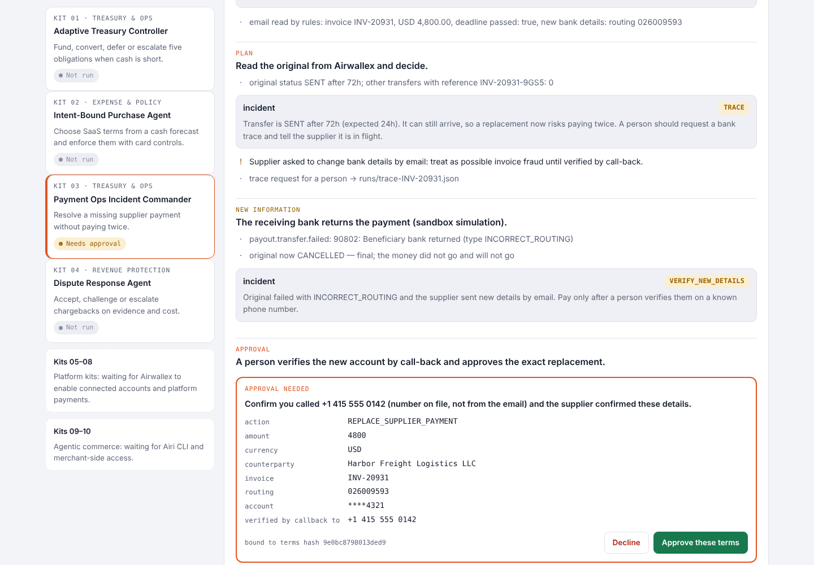
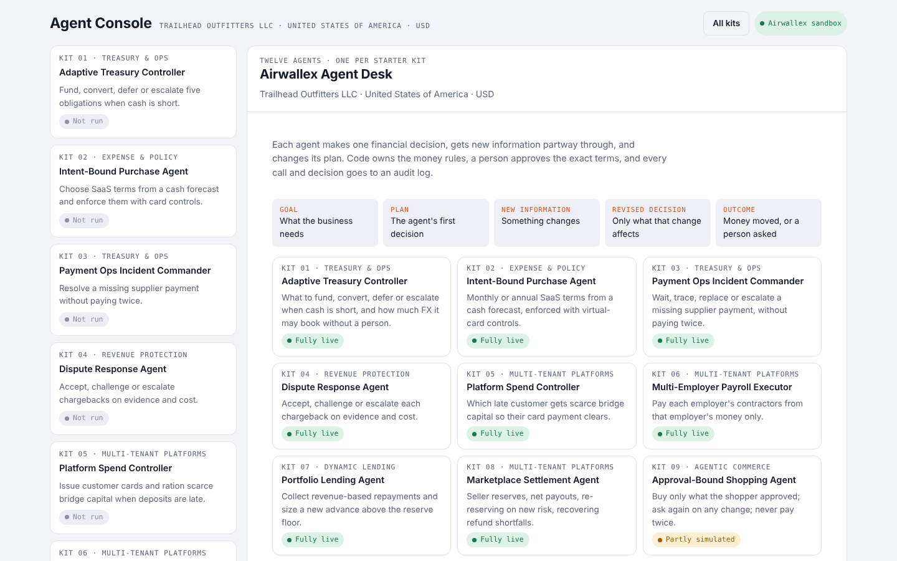
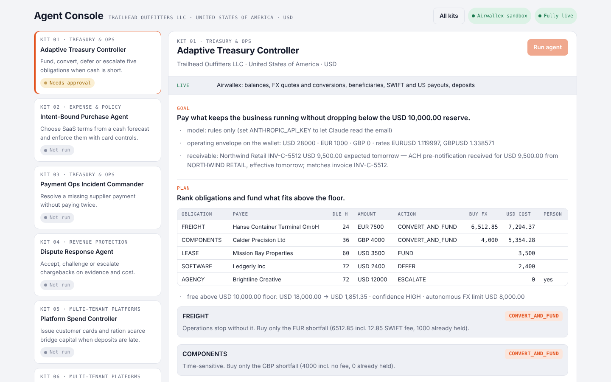
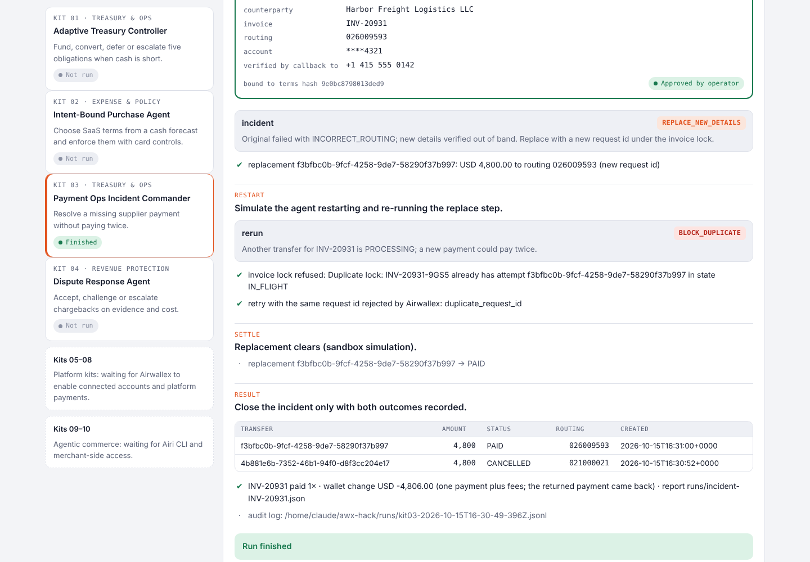
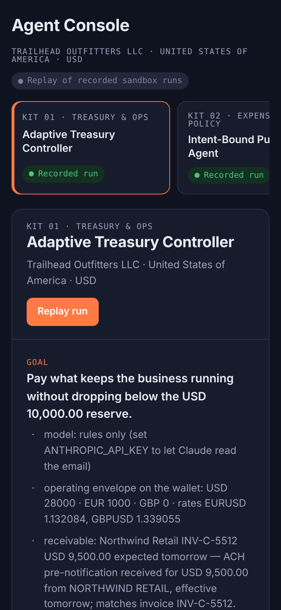

# Airwallex Agent Desk

Twelve finance agents for **Trailhead Outfitters LLC**, a US business, built on the [Airwallex](https://www.airwallex.com) sandbox for the [Airwallex agentic banking hackathon](https://airwallexdev.com). One agent per starter kit, kits 1 to 12. Each agent makes a financial decision, changes it when a balance, deadline, piece of evidence or risk changes, and then moves money or hands the decision to a person.

**Sandbox only. No real money.** All names, accounts and products are synthetic. This is not official Airwallex documentation.



## Contents

- [Submission at a glance](#submission-at-a-glance)
- [The agents](#the-agents)
- [Quick start](#quick-start)
- [Running the agents](#running-the-agents)
- [Kit setup and enablement](#kit-setup-and-enablement)
- [How this follows the hackathon guide](#how-this-follows-the-hackathon-guide)
- [Live and emulated](#live-and-emulated)
- [Configuration](#configuration)
- [Tests](#tests)
- [Project layout](#project-layout)
- [What we learned about the sandbox](#what-we-learned-about-the-sandbox)
- [More documentation](#more-documentation)

## Submission at a glance

| Requirement | Where |
|---|---|
| **Working demo** | `npm run console`, then open http://localhost:4310 and run any kit against your own sandbox ([Quick start](#quick-start)). Without credentials, open `preview/agent-console.html`, which replays recorded runs of all twelve kits. |
| **Video under 5 minutes** | A walkthrough of all twelve kits running in the console, linked in the submission. |
| **Repository with setup instructions** | This README: [Quick start](#quick-start), [Kit setup and enablement](#kit-setup-and-enablement), [Troubleshooting](docs/TROUBLESHOOTING.md). |
| **Uses Airwallex APIs** | Every kit calls the Airwallex sandbox REST API: authentication, balances, Global Accounts, simulated deposits, FX rates, quotes and conversions, beneficiaries, transfers and transfer simulations, card issuing (cardholders, cards, controls, transactions), payment intents (confirm, pre-authorization, increment, capture, cancel), disputes and dispute simulations, file uploads, connected accounts. Each run writes every call to an audit log in `runs/`. |

## The agents

| Kit | Track | Agent | The decision it makes |
|---|---|---|---|
| [01](kits/01-adaptive-treasury/README.md) | Treasury & Ops | Adaptive Treasury Controller | What to fund, convert, defer or escalate when cash is short, and how much FX it may book without a person |
| [02](kits/02-intent-bound-purchase/README.md) | Expense & Policy | Intent-Bound Purchase Agent | Monthly or annual SaaS terms from a cash forecast, enforced with virtual-card controls |
| [03](kits/03-payment-ops-incident/README.md) | Treasury & Ops | Payment Ops Incident Commander | Wait, trace, replace or escalate a missing supplier payment without paying twice |
| [04](kits/04-dispute-response/README.md) | Revenue Protection | Dispute Response Agent | Accept, challenge or escalate chargebacks on evidence and cost |
| [05](kits/05-platform-spend/README.md) | Multi-Tenant Platforms | Platform Spend Controller | Which late customer gets scarce bridge capital so their card payment clears |
| [06](kits/06-multi-employer-payroll/README.md) | Multi-Tenant Platforms | Multi-Employer Payroll Executor | Pay each employer's contractors from that employer's money only |
| [07](kits/07-portfolio-lending/README.md) | Dynamic Lending | Portfolio Lending Agent | Collect revenue-based repayments and size an advance above the reserve floor |
| [08](kits/08-marketplace-settlement/README.md) | Multi-Tenant Platforms | Marketplace Settlement Agent | Seller reserves, net payouts, re-reserving on new risk, recovering refund shortfalls |
| [09](kits/09-approval-bound-shopping/README.md) | Agentic Commerce | Approval-Bound Shopping Agent | Buy only what the shopper approved, ask again on any change, never pay twice |
| [10](kits/10-merchant-agentic-checkout/README.md) | Agentic Commerce | Merchant-Enabled Agentic Checkout | Sell through an AI assistant via the merchant's MCP tools and a hosted payment page |
| [11](kits/11-x402-business-agents/README.md) | Agent Payments | x402 Business Agents | Three agents sharing 20 *USDZ: whose limits move, and from where, when a supplier's price rises; which disputed charges to refund |
| [12](kits/12-inference-sourcing/README.md) | Inference Sourcing | Inference Sourcing Agent | Which provider each AI step is bought from, and how card holds and a short float stretch when a job overruns |

Every run shows the five parts the guide asks for: the **goal**, the agent's **plan**, the **new information**, the **revised decision**, and the resulting **balance, payment or status**.

## Quick start

These steps follow the guide's **Get running** section in order.

### 1. Prerequisites

- **Node.js 22 or later** (`node --version`). An `.nvmrc` is included, so `nvm use` picks the right version.
- **An Airwallex sandbox account.** Sign up at [sandbox.airwallex.com](https://www.sandbox.airwallex.com/global/signup) with an email you can read (team invitations arrive there). If you add a business, name it exactly `Sandbox Business` or `New Business Sandbox`; any other name stays **In review**.

### 2. Create an API key

In the sandbox web app, open **Account → Developer → API keys** and create a key:

- **IP allowlist:** leave it empty.
- **Access:** read and write on balances, Global Accounts, FX, beneficiaries, transfers, issuing, payments, files and simulation.

Treat the key like a password. Never commit it.

### 3. Install

```sh
git clone https://github.com/Rokit12/airwallex.git
cd airwallex
npm install
npm run setup:browser        # Chromium for kits 9 and 10
```

### 4. Add your keys

```sh
cp .env.example .env
```

Open `.env` and fill in `AWX_CLIENT_ID` and `AWX_API_KEY`. Git ignores this file.

### 5. Verify, then fund the sandbox

```sh
npm run check                # logs in, lists Global Accounts and balances
npm run fund                 # simulates a deposit if USD is below 25,000
```

`check` is the guide's verification step: if login works, it lists your Global Accounts (an empty list still means authentication worked). `fund` uses an existing USD Global Account, creates one only if none suits, and simulates a deposit. The deposit shows immediately even though its response says `PENDING`.

### 6. Run an agent

```sh
npm run console              # then open http://localhost:4310
```

Pick a kit and press **Run agent**. When the agent needs a person, the run stops on an approval card. Press **Approve these terms** or **Decline**.

### 7. Optional: connect the Airwallex MCP servers

The guide recommends these for your coding agent while building. The project itself calls the REST API, so it doesn't need them to run. Add the docs server first, since it needs no account:

```sh
claude mcp add-json airwallex-docs '{ "type": "http", "url": "https://mcp.sandbox.airwallex.com/docs" }'
claude mcp add-json airwallex-dev '{ "type": "http", "url": "https://mcp.sandbox.airwallex.com/developer" }'
```

Other clients (Cursor, Codex, Gemini CLI, Windsurf) use the same two URLs. Don't use the AgentOS MCP here; it is for production accounts.

### If setup fails

Check four things in order:

1. The business is not **In review**.
2. The API key has the access listed in step 2.
3. `npm run check` logs in.
4. A funded USD Global Account exists.

[docs/TROUBLESHOOTING.md](docs/TROUBLESHOOTING.md) lists every error seen while building, with fixes.

## Running the agents

### Web console

`npm run console` serves the Agent Console at http://localhost:4310. It opens on an overview of all twelve agents, each marked fully live or partly simulated. Each run shows a strip of what runs live and what is simulated (and why), then streams the agent's goal, its plan, incoming documents (emails, bank notices, price changes), every decision with its reason, tables and approvals, and ends with an outcome card: the result, the decisions made in code, and the approvals a person gave.



| A run, with what's live | The outcome card | Phone, dark mode |
|---|---|---|
|  |  |  |

### Terminal

```sh
npm run kit1                 # … through npm run kit12
npm run demo                 # kit 1, then kit 3
```

Approval prompts wait for your answer in the terminal (type `y` and press Enter).

### Run everything

```sh
APPROVE=yes npm run record   # runs all twelve kits end to end, approving automatically
npm run build:replay         # writes preview/agent-console.html from those runs
```

`preview/agent-console.html` is a single file that replays the recorded runs without a server or credentials.

### Let an AI assistant shop the test store (kits 9 and 10)

```sh
npm run store                # storefront on :4320, MCP endpoint at /mcp
claude mcp add-json trailhead-store '{"type":"http","url":"http://localhost:4320/mcp"}'
```

Then ask, for example: "Find me a set of insulated water bottles under $85 with returns."

## Kit setup and enablement

The guide lists what each kit needs. Kits whose feature isn't enabled on your account still run end to end: the refused part switches to an emulator built from the documented behaviour, and the console labels the run (see [Live and emulated](#live-and-emulated)).

| Kit | Setup from the guide | What to do |
|---|---|---|
| 1, 2, 3 | Fund a wallet | `npm run fund` |
| 4 | No extra enablement | None. If confirming a card returns `not enabled for native API access`, ask devhelp@airwallex.com to enable native API access for payments |
| 5, 7, 8 | Request platform access | Email devhelp@airwallex.com for connected accounts and platform payments |
| 6 | Platform access + 3 accounts | As above; the kit opens its three employer accounts itself |
| 9 | Allowlisted Airi CLI access | Sign up at [app.airi.com](https://app.airi.com) and ask devhelp@airwallex.com to allowlist that email for the Airi CLI beta. Install it (`npm install -g @airwallex/airi-cli@beta`), sign in (`airi-cli auth login`), pick an agent-enabled card (`airi-cli payment-methods list`) and set `AIRI_PAYMENT_METHOD_ID`. Until Airi's test mode is released, a mandate uses a real card, so the kit uses the sandbox test card unless you set it |
| 10 | Merchant-side access | Email devhelp@airwallex.com. The kit's own merchant MCP server runs locally meanwhile |
| 11 | Funded Metal testnet wallet | See [Metal testnet](#metal-testnet-kits-11-and-12) below |
| 12 | Metal testnet access | See [Metal testnet](#metal-testnet-kits-11-and-12) below |

Plan for lead time on enablement. A quick way to test whether a feature is on yet is to run the kit with `RAILS=live`, which turns the fallback off and fails fast:

```sh
RAILS=live npm run kit5
```

### Metal testnet (kits 11 and 12)

1. Sign in at [console-testnet.metalntwx.com](https://console-testnet.metalntwx.com) and finish billing setup. It accepts an Airwallex sandbox test card, for example `4035501000000008` with any future expiry and CVC, and gives you test credit.
2. Create an endpoint on **testnet** and add it to `.env` as `METAL_RPC_URL=https://rpc-testnet.metalntwx.com/v1/<id>`.
3. Check the live path:

   ```sh
   npm run metal:check
   ```

   This confirms the chain (63825), reaches Metal's x402 facilitator, funds a key from the faucet, and makes a real x402 payment to this project's own seller. Then it binds a spending limit (3 cents a payment), pays 2 cents under it, and has a 4-cent payment refused on chain. It prints each transaction and its explorer link. Keys are kept in `.metal/`, which git ignores. It needs `@metalntwx/metal-agent` 0.3.3 or later, which `npm install` provides.

   Kit 12 then uses Metal clearing live (`clearing-testnet.metalntwx.com`). A live run takes 15–20 minutes, because Metal releases withdrawals only after two 5-minute challenge windows. `METAL=emulated npm run kit12` runs it on the emulator in about 30 seconds. Afterwards, `npm run metal:withdraw` (run it twice, about five minutes apart) returns unspent deposits to the operator.

Faucet limits: ten grants per IP per UTC day, one per minute. Each grant tops an address up to 100 USDZ.

## How this follows the hackathon guide

### Build around a financial decision

| The guide says | How it's done here |
|---|---|
| Choose a finance task someone repeats and find the decision inside it | Each kit's "decision it makes" in [the agents table](#the-agents) |
| The agent chooses differently when a balance, deadline, evidence or risk changes | Every run has a **new information** step that changes a decision: a late receivable (kit 1), a price rise (kits 2, 11), a disputed batch (kit 11), a bank return (kit 3), new dispute evidence (kit 4), a token overrun (kit 12) |
| Let the agent move money or update financial state, and say which actions need a person | Each kit moves money or state in the sandbox; actions above policy limits stop on an approval card |
| Show goal, plan, new information, revised decision, resulting balance | The console's GOAL, PLAN, NEW INFORMATION, DECIDE and RESULT sections in every run |
| Keep amounts, limits, reserves, validation, duplicate protection and state transitions in code | `kits/*/policy.ts`: pure functions with tests (`kits/*/policy.test.ts`); `src/core/lock.ts` for duplicate protection |
| Use the model to read unstructured text, compare evidence, propose a plan and explain an exception | `src/core/llm.ts`: optional model extraction and explanation (`ANTHROPIC_API_KEY`), validated against a type and checked against the ledger. Without a key, deterministic rules reach the same decisions |
| Give the model typed tools rather than unrestricted credentials | The model never sees credentials or card data; kit 10's assistant gets typed MCP tools (`src/commerce/server.ts`) |
| Bind each approval to amount, currency, counterparty, terms and evidence | `src/core/approval.ts`: an approval is a SHA-256 hash of the exact terms shown; any change invalidates it |
| Put sandbox-only simulation calls behind one interface | `src/core/sandbox.ts` (deposits, transfer transitions, card authorizations, disputes) |
| Finish with a financial action or an escalation to a person | Every run ends with a payout, capture, refund, card change or escalation file |
| If the agent should make the same choice every time, write the rule in code | The model never chooses an amount; policy functions do |

### Safety rules

| The guide says | How it's done here |
|---|---|
| Sandbox data only, synthetic names, accounts and products | `src/core/client.ts` refuses any non-sandbox host; fixtures are synthetic |
| Never commit API credentials | Keys live in `.env` and `.metal/`, both git-ignored; `.env.example` has empty values |
| Give each agent its own key; keep the account-controlling key away from agents (kit 11) | Each kit 11 agent pays under its own mandate; the owner key only signs limit changes after approval |
| Keep card data and payment credentials out of model context and the browser (kit 9) | Card numbers go from the credentials provider straight into the hosted payment form, never to a model, and are redacted from logs (`src/core/audit.ts`) |
| Treat timeouts as unconfirmed and check the prior attempt before retrying | Kits 3, 9, 10 and 11 re-read state before any retry; `src/core/sandbox.ts` re-reads after a 5xx |
| Enforce tenant isolation in code (platform kits) | Kits 5 to 8 check each customer's own balance; kit 6 shows the bug a pooled check would cause |

### Sandbox conventions

| The guide says | How it's done here |
|---|---|
| Log in with `x-client-id` and `x-api-key`; the token lasts 30 minutes | `src/core/client.ts` caches the token and refreshes it early |
| Fresh UUID `request_id` per operation; reuse it only to retry the same one | `newRequestId()` per operation; retries reuse it, and kit 3 shows Airwallex rejecting a reuse with `duplicate_request_id` |
| Amounts are major units | All Airwallex amounts in code are major units; Metal amounts are converted from base units in `src/metal/units.ts` |
| Branch on FAILED and CANCELLED (FAILED auto-cancels in seconds) | Kit 3 keeps the failure reason from the event, before the auto-cancel |
| Use NL, DE or FR for EUR | Kit 1's EUR beneficiary is in Germany |

## Live and emulated

Every kit calls the real Airwallex sandbox first. If Airwallex refuses a feature that hasn't been enabled for an account, only that part of the run switches to an emulator built from documented behaviour. The console labels it **Card rail emulated**, **Platform rail emulated** or **Metal rail emulated**, and the run explains why. The same code goes live as soon as the feature is enabled.

Status on our US sandbox account: **every Airwallex call in all twelve kits runs live.**

| Kits | Live on Airwallex | Not live yet |
|---|---|---|
| 1, 3 | FX, SWIFT and ACH payouts, bank returns | – |
| 2 | Virtual card issuing, card controls, authorizations and declines | – |
| 4 | Payments, real disputes (accept, challenge, escalate, resolve), evidence uploads | – |
| 5 | Connected accounts (KYC, submit, activate), cards issued on each customer's behalf, authorizations, bridge transfers, fee charges | – |
| 6, 7 | Connected accounts, payroll and loan flows, FX and payouts | – (FX and payouts inside connected accounts are routed through the platform account, see below) |
| 8 | Connected accounts, seller payouts, reserves, refunds | – |
| 9, 10 | Browser shopping, merchant MCP checkout, live card payments and declines | Kit 9: Airi CLI card credentials (wired to the real CLI; uses the sandbox test card until Airi releases test mode). Kit 10: Airwallex's merchant-side Agentic Commerce (awaiting access; the local merchant MCP runs meanwhile) |
| 11 | Deposits credited by Metal transaction hash, FX to EUR, SWIFT payout of the licence fee | Metal spending limits for the kit's 200+ payments (each on-chain payment takes seconds and faucet-limited gas; `npm run metal:check` proves the same limits live: bind, pay under, refused over) |
| 12 | Card pre-authorization holds, increments, single captures, cancels · Metal clearing on testnet: deposits, signed running totals, withdrawals | Nothing when Metal's clearing service is reachable. A live run takes 15–20 minutes because withdrawals wait for Metal's challenge windows; `METAL=emulated` runs it in 30 seconds |

**FX and payouts inside connected accounts.** Airwallex has not configured fee pricing for FX conversions and payouts made on a connected account's behalf (`unconfigured_client_fee`, `fee_unknown`). Kits 6 and 7 then route those operations through the platform account, live: the customer's own balance is charged, the platform converts or pays out, and converted money goes back to the customer. Each customer's money still only pays for that customer.

On Metal testnet, faucet funding, x402 payments and spending limits (bind, pay under the cap, refused over it) are live: `npm run metal:check` proves them. Kit 12's clearing runs live on testnet too; `npm run metal:withdraw` brings unspent clearing deposits back to the operator after Metal finalizes them.

## Configuration

All settings live in `.env` (see [`.env.example`](.env.example)).

| Variable | Required | Purpose |
|---|---|---|
| `AWX_CLIENT_ID`, `AWX_API_KEY` | Yes | Airwallex sandbox credentials |
| `METAL_RPC_URL` | Kits 11–12, optional | Metal testnet RPC endpoint; enables `npm run metal:check` |
| `METAL` | No | `emulated` forces the Metal emulator |
| `ANTHROPIC_API_KEY` | No | Lets a model read emails, quotes and notes and explain decisions. Without it, deterministic rules reach the same decisions |
| `AGENT_MODEL` | No | Model for the above |
| `APPROVE` | No | `yes` approves every request automatically (unattended runs); `no` declines |
| `APPROVER` | No | Name recorded on approvals |
| `DEMO_PACE` | No | Milliseconds to pause between story beats, for recordings |
| `RAILS` | No | `live` disables the emulator fallback; `emulated` forces it |
| `PORT`, `STORE_PORT` | No | Console port (4310) and storefront port (4320) |
| `AIRI_PAYMENT_METHOD_ID` | No | Kit 9: the Airi card to pay with (`airi-cli payment-methods list`). Set it to use the Airi CLI instead of the sandbox test card |
| `AIRI_CLI` | No | Path to `airi-cli` if it is not on your PATH |

Behind a proxy on Node 22+, run with `NODE_USE_ENV_PROXY=1`.

## Tests

```sh
npm test                     # 64 policy tests across all twelve kits
npm run typecheck
npm run verify               # both, as CI runs them
```

The tests cover every kit's decision logic and need no credentials. GitHub Actions runs `npm run verify` on every push.

## Project layout

```
kits/NN-name/
  policy.ts          the decisions (pure functions)
  policy.test.ts     tests that pin them
  fixtures.ts        synthetic data for the demo
  run.ts             the demo flow against the sandbox
  README.md          what the kit shows and how to run it
src/core/            Airwallex client, sandbox simulations, emulators, approvals, lock, audit, model calls
src/console/         web console server, kit runner, recorder, replay builder
src/commerce/        test storefront, merchant MCP server, card credentials provider
src/metal/           Metal: x402 sellers (live and local), emulator, live check
ui/index.html        the console page
docs/                architecture, troubleshooting, screenshots
preview/             replay page built from recorded runs
runs/                audit logs and run outputs (git-ignored)
```

## What we learned about the sandbox

- **Failed transfers end CANCELLED, and the failure reason disappears** within seconds. The agents keep it from the failure event.
- **A transfer transition can return HTTP 500 and still apply.** The agents re-read before trusting any error, and retry with growing waits.
- **SWIFT fees can differ from the documented flat fee:** EUR 13.40 was charged against EUR 12.85 expected. Kit 1 flags the variance.
- **ACH payouts can carry a fee.** The agents read `fee_amount` from each transfer instead of assuming LOCAL is free.
- **Reusing a `request_id` returns `duplicate_request_id`.** Kit 3 relies on this as its second defence against paying twice.
- **A declined card is an HTTP 400 (`issuer_declined`), not a status,** and the intent stays open for another card. Kits 9 and 10 handle both shapes.
- **A pre-authorized intent can be raised with `increment_authorization` and captured once.** A second capture is refused, so kit 12 captures exactly once from the clearing position.
- **Dispute evidence dates must be strict ISO 8601** (`2026-09-30T10:00:00Z`).
- **UK beneficiaries are validated against real sort codes.** Use `POST /beneficiaries/validate` to check details before creating one.

## More documentation

- [Architecture](docs/ARCHITECTURE.md): layers, decision flow, core modules, console event protocol
- [Troubleshooting](docs/TROUBLESHOOTING.md): login, access, Metal and run-time issues
- Each kit's README, linked in [the agents table](#the-agents)

## License

[MIT](LICENSE). You are responsible for how you use keys, agents and these examples.
