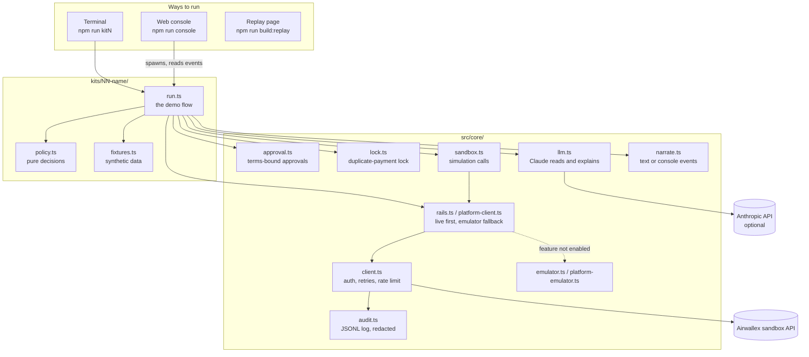

# Architecture

This project is twelve small agents that share one core. Each agent is a plain TypeScript script that reads state from Airwallex, makes decisions in tested policy code, asks a person when policy says so, and moves money. A web console runs the same scripts and streams what they do.

## Layers



**Rule of the codebase:** money decisions live in `policy.ts` and nowhere else. `run.ts` gathers facts, calls the policy, asks for approval, and executes. The model never chooses an amount.

## How one decision becomes money movement

```mermaid
sequenceDiagram
  participant Run as run.ts
  participant AWX as Airwallex
  participant LLM as Claude (optional)
  participant Pol as policy.ts
  participant Person
  Run->>AWX: read balances, transfers, disputes…
  Run->>LLM: extract facts from an email / quote / notes
  LLM-->>Run: JSON, validated; ledger wins on disagreement
  Run->>Pol: decide(facts)
  Pol-->>Run: action, amount, needsApproval, rationale
  alt needs a person
    Run->>Person: exact terms (amount, currency, counterparty, evidence)
    Person-->>Run: approval = hash of those terms
    Run->>Run: assertApproved(currentTerms, approval)
  end
  Run->>AWX: execute with a request_id (lock written first)
  AWX-->>Run: response, or an error treated as unconfirmed
  Run->>AWX: re-read the object before deciding anything else
```

## The core modules

| Module | What it does |
|---|---|
| `client.ts` | Logs in with `x-client-id` / `x-api-key`, caches the 30-minute token and refreshes early. Spaces calls to stay under the sandbox rate limit and backs off on 429. Retries a POST only when it carries a `request_id`. Refuses to run against any non-sandbox host. |
| `rails.ts` | For card issuing and card acceptance: tries the live API, and switches that rail to `emulator.ts` only when Airwallex refuses the feature for the account. |
| `platform-client.ts` | Same idea for kits 5–8: switches to `platform-emulator.ts` when Airwallex refuses to open connected accounts. FX rates and quotes always stay live, and so does card issuing: cards are issued on the platform's own account and each card's per-transaction limit is set to the customer's wallet before every authorization, so Airwallex makes the approve/decline call. |
| `emulator.ts` | Card issuing and payment acceptance, following documented rules: inclusive per-transaction limits, cumulative monthly limits, decline reasons, documented decline test cards, dispute stage transitions. |
| `platform-emulator.ts` | Per-account wallets, `x-on-behalf-of`, connected-account transfers and charges that settle after creation, the three insufficient-funds codes, SWIFT fees, on-behalf transfers that stay PROCESSING until simulated. |
| `sandbox.ts` | Every sandbox-only simulation (deposits, card authorizations, transfer transitions, disputes) behind one interface. Treats a 5xx on a transition as unconfirmed and re-reads. |
| `approval.ts` | An approval is a SHA-256 hash of the exact terms shown. `assertApproved` throws if anything changed since. Works in the terminal, in the console, or unattended with `APPROVE=yes`. |
| `lock.ts` | One lock per obligation (invoice, payroll line). Written before the API call with the `request_id`, so a crash can be recovered by asking Airwallex about that `request_id` instead of paying again. |
| `llm.ts` | Optional Claude calls: extract structured facts from text (validated against a type guard) and explain decisions in plain language. Without `ANTHROPIC_API_KEY`, deterministic rules give the same decisions. |
| `audit.ts` | Appends every API call, decision and approval to `runs/kitNN-<time>.jsonl`, with card numbers, CVCs and tokens redacted. |
| `narrate.ts` | Prints the story in the terminal, or emits structured events when run under the console. |
| `business.ts` | The one business profile every kit acts for: Trailhead Outfitters LLC, United States of America, USD. |

## Metal (kits 11 and 12)

| Module | What it does |
|---|---|
| `src/metal/live-seller.ts` | A real x402 seller on Metal testnet: the official `@x402/express` middleware with Metal's `exact` scheme (`@metalntwx/metal-pay`), settled by Metal's testnet facilitator. Prices are read on every request. |
| `src/metal/check.ts` | `npm run metal:check`: chain id, facilitator, faucet, then one real x402 payment to the live seller, paid by `metal-agent` from a separate process. |
| `src/metal/emulator.ts` | Metal's documented rules for what is not live yet: accounts, mandates (payees, per-payment cap, lifetime budget, expiry, replace carrying spend), refusals that name the limit and move nothing, payments by id paid at most once, a chain log for `verify`, and clearing (one deposit per key, cumulative signed totals, deposits counted from the next epoch, withdrawals after their epoch). |
| `src/metal/x402.ts` | Local x402 over HTTP for the emulated rail: `402` offers, payment headers, a facilitator that verifies and settles. |
| `src/metal/rail.ts` | Opens the Metal rail and states why any part runs on the emulator. |
| `src/metal/units.ts` | *USDZ amounts: 18-decimal base units, whole cents for mandates, micros (a millionth) for clearing. |

## Console event protocol

`npm run console` starts `src/console/server.ts`. When you press **Run agent**, `runner.ts` spawns the kit's `run.ts` with `UI_EVENTS=1`. The kit then writes one event per line to stdout:

```
@@EV {"type":"beat","label":"plan","text":"Rank obligations…","t":1792080000000}
```

| Event | Fields | Shown as |
|---|---|---|
| `title` | `text`, `business`, `country`, `currency` | Run header |
| `beat` | `label`, `text` | Section heading (GOAL, PLAN, NEW INFORMATION…) |
| `step` / `ok` / `warn` / `fail` | `text` | Lines with an icon |
| `decision` | `subject`, `action`, `why` | Decision card with an action badge |
| `table` | `rows` | Table |
| `document` | `text` | Incoming email or notice |
| `approval_request` | `id`, `context`, `terms`, `termsHash` | Approval card with Approve / Decline |
| `approval_result` | `id`, `approved`, `by` | Updates the approval card |
| `run_started` / `run_finished` | `runId`, `code`, `error` | Start and final banner |

The server streams these to the browser with server-sent events. **Approve** and **Decline** post to `/api/approve`, and the server writes `{"id","approve","by"}` to the kit's stdin, which `approval.ts` is waiting on. Every finished run is saved to `runs/console/`; `npm run build:replay` bundles the latest successful run of each kit into a single page that replays without a server.

## The test storefront (kits 9 and 10)

`src/commerce/` is a small merchant used by both commerce kits:

- `catalog.ts`: 120 deterministic synthetic products.
- `store.ts`: carts, checkouts with idempotency keys, orders. Payments go through Airwallex payment intents (create for the checkout total, confirm with the card from the hosted page).
- `server.ts`: HTML pages for the browser agent, the hosted payment page, an order-status page used before any retry, and the MCP endpoint at `/mcp`.
- `credentials.ts`: where the shopping agent gets card credentials: Airi CLI when configured, otherwise the sandbox test card.

## Design choices worth knowing

- **One request id per operation.** New payments always get a new UUID; retries of the same operation reuse it. Airwallex rejects a reused id with `duplicate_request_id`, which kit 3 relies on as a second line of defence.
- **Errors are unconfirmed, not failures.** The sandbox can return HTTP 500 and still apply a transition, and a failed transfer loses its `failure_reason` once it auto-cancels. The agents re-read state, and keep failure details from the event.
- **Tenants are never pooled.** Platform kits check each connected account's own balance. Kit 6 shows the bug a pooled check would cause.
- **Card data never reaches a model.** Card numbers go from the credentials provider (or the shopper) straight into the hosted payment form, and are redacted from logs.
